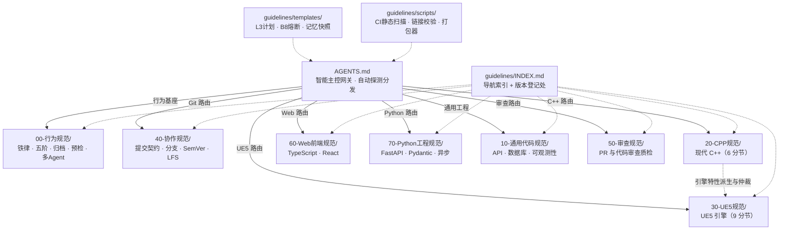

# AI Coding Standards (AI 编程规范体系)

> 面向 AI 编程助手（Agent）的**模块化、编号化、单一事实源 (SSOT)** 规范体系。  
> 采用 **"智能主控网关 + 行为规范与代码规范解耦 + 标准模板 + 自动化工具"** 架构，覆盖全局 AI Agent 工作流、多智能体协同、通用多语言、现代 C++、UE5 游戏引擎、Web 前端与 Python 工程，全平台统一通过 `AGENTS.md` 驱动，可无缝嵌入 Trae / Cursor / Copilot / Windsurf / Claude 等主流 AI 工具。

---

## 🚀 一键安装至你的工程 (One-Click Installation)

只需在你本地项目的根目录下执行对应系统的一行命令，即可自动将全套规范（含标准交付模板与自动化脚本）部署就绪：

### macOS / Linux / WSL
```bash
curl -fsSL https://raw.githubusercontent.com/YIice-cwj/ai_coding_standards/main/install.sh | bash
```

### Windows (PowerShell)
```powershell
irm https://raw.githubusercontent.com/YIice-cwj/ai_coding_standards/main/install.ps1 | iex
```

### Windows (CMD / 双击运行)
下载本仓库中的 `install.bat` 置于项目根目录双击执行，或在 CMD 中运行：
```cmd
curl -fsSL -o install.bat https://raw.githubusercontent.com/YIice-cwj/ai_coding_standards/main/install.bat && install.bat
```

> **🛡️ 智能防误触与备份保护机制**：
> - 若检测到目标目录已存在 `AGENTS.md` 或 `guidelines/`，脚本会**主动暂停并提示确认**，防止冲掉已有配置。
> - 默认选项 `[1]` 会**自动将旧版规范备份至 `.guidelines_backup_<时间戳>/`**，再部署最新版，保证绝对安全！
> - 若用于 CI/CD 自动化构建，追加 `-y` 或 `--force` 参数（如 `... | bash -s -- -y`）即可免交互静默覆盖。

---

## 终极极简使用方式：统一使用唯一入口 —— `AGENTS.md`

无需在不同工具间维护多份 `.cursorrules`、`.windsurfrules` 等分裂配置，本项目通过 **自举式智能主控网关 ([AGENTS.md](./AGENTS.md))** 实现全平台大一统：

* **全平台通用**：你在对话中**永远只需要给 AI 这一个文件**（如 `@AGENTS.md 帮我写一个xxx`），或在 Cursor/Trae/Windsurf/Copilot 的设置中将 `AGENTS.md` 指定为项目唯一的 System Prompt。
* **AI 自动化自举执行**：
  1. `AGENTS.md` 内置了不可跳过的**行为宪法（计划先行、严格最小变更、非必死不判断、未获指令禁提交）**，防越权机制 100% 物理生效！
  2. `AGENTS.md` 自带**动态任务路由器**，AI 会根据指令关键词自动探测领域（C++ / UE5 / Web / Python / 通用 / 审查 / Git / 多Agent），并主动调阅对应领域的分节规范，绝不浪费无关 Token。



---

## 仓库结构与定位

整个规范体系仅收敛为根目录入口与 `guidelines/` 统一目录，结构极简清晰：

```
.
├── AGENTS.md                          # 【智能主控网关】唯一总指挥入口！自动探测任务并分发子规范
├── README.md                          # 项目全局架构与拓扑指南
├── install.sh                         # 【一键安装】macOS / Linux / WSL 一键安装部署脚本
├── install.bat                        # 【一键安装】Windows CMD 一键安装部署脚本
├── install.ps1                        # 【一键安装】Windows PowerShell 一键安装部署脚本
└── guidelines/                        # 【全套规范知识总库】
    ├── INDEX.md                       # 【导航 + 版本登记处】单主题导航地图 · 规则 ID 速查 · 版本权威表
    ├── templates/                     # 【标准交付模板库】L3计划(B2) · B8三振求助 · 记忆快照(B6) · 审查报告
    │   ├── L3_PLAN_TEMPLATE.md
    │   ├── B8_CIRCUIT_BREAKER_REPORT.md
    │   ├── MEMORY_SNAPSHOT_TEMPLATE.md
    │   └── CODE_REVIEW_TEMPLATE.md
    ├── scripts/                       # 【自动化工程工具】CI/Pre-commit 静态扫描与打包工具
    │   ├── verify_links.py            # 全库相对链接与锚点完整性静态扫描
    │   ├── lint_rules.py              # 规范一票否决项自动化静态合规扫描
    │   └── bundle_prompt.py           # 单文件系统提示词打包编译器
    ├── 00-行为规范/                   # 【全局行为宪法】规则 SSOT（含多Agent与MCP安全）
    ├── 10-通用代码规范/               # 【多语言通用基准】（API契约/数据库/可观测性）
    ├── 20-CPP规范/                    # 【现代 C++ 专用】（15层布局/现代特性/内存）
    ├── 30-UE5规范/                    # 【UE5 引擎特化】（反射/GC/网络生命周期）
    ├── 40-协作规范/                   # 【版本协作标准】（B-GIT 提交权限/SemVer）
    ├── 50-审查规范/                   # 【代码审查规范】（审查矩阵与输出标准）
    ├── 60-Web前端规范/                # 【现代 Web 特化】（TS严格模式/React闭包与水合）
    └── 70-Python工程规范/             # 【Python 工程特化】（严格类型/Pydantic/异步安全）
```

### 各规范职责划分

| 域 / 目录 | 定位与核心内容 | 适用场景 |
|---|---|---|
| **[AGENTS.md](./AGENTS.md)** | **智能主控总指挥网关**：核心宪法、动态规范路由表、CoT 协议 | 向 AI 提供的唯一入口文件 |
| **[guidelines/templates/](./guidelines/templates/)** | **标准交付模板库**：L3/L4 方案对比、B8 阻断报告、记忆快照、审查报告 | 规范交付输出时填空使用 |
| **[guidelines/scripts/](./guidelines/scripts/)** | **自动化工程防呆**：链接校验、规范 Lint 扫描、Prompt 单文件打包 | CI/CD 与 Git Hook 门禁 |
| **[00-行为规范](./guidelines/00-行为规范/01-核心铁律与五阶执行模型.md)** | **Agent 最高行为协议**：铁律（B1~B8）、五阶状态机、Bug 根因修复、多Agent信封与 MCP 安全 | 所有编程任务的基础行为底座 |
| **[10-通用代码规范](./guidelines/10-通用代码规范/01-风格命名与注释.md)** | **多语言通用基准**：代码自解释、API 契约、零停机数据库演进与可观测性 | 通用工程、服务端与系统开发 |
| **[20-CPP规范](./guidelines/20-CPP规范/01-格式命名与注释.md)** | **现代 C++ 专用标准**：15 层类排布、`concept`、NRVO、智能指针、并发安全 | 现代 C++ 项目（C++20/23/17） |
| **[30-UE5规范](./guidelines/30-UE5规范/01-命名格式与注释.md)** | **UE5 引擎特化标准**：UHT 反射宏、GC 内存、网络复制与 RPC、Gameplay 生命周期 | Unreal Engine 5 C++ 游戏开发 |
| **[60-Web前端规范](./guidelines/60-Web前端规范/01-TypeScript与基础规范.md)** | **现代 Web 前端标准**：TS 强类型窄化、React Hooks 闭包防御、状态下沉、SSR 水合安全 | React / Next.js / TypeScript 开发 |
| **[70-Python工程规范](./guidelines/70-Python工程规范/01-风格类型与现代特性.md)** | **Python 工程特化标准**：严格类型标注、Pydantic v2、asyncio 非阻塞并发、Poetry 锁 | Python 后端 / 数据与 AI 工程 |
| **[40-协作规范](./guidelines/40-协作规范/01-Git协作与版本规范.md)** | **版本协同与发布标准**：B-GIT 提交权限铁律、结构化提交契约、分支模型、SemVer | Git 提交、分支与版本管理 |
| **[50-审查规范](./guidelines/50-审查规范/01-代码审查规范.md)** | **代码质检审查规则**：过度防御一票否决、零行内注释核查、地表止痛否决、安全凭据扫描 | PR / MR 审查、自动化 Code Review |

---

## 跨工具通用驱动方式

由于规范已实现自举与自包含，不再需要为每个 IDE 分别维护分裂的适配文件：

- **日常对话直接使用（最推荐）**：  
  在任意 AI 工具（Cursor, Trae, Copilot, Windsurf, Claude）的输入框中通过 `@` 挂载 `AGENTS.md`：
  ```text
  @AGENTS.md 帮我重构用户鉴权模块。
  ```
- **设为项目统一规则**：
  在各工具的 Project Rules / Custom Instructions 中直接指定：`请严格以此工程根目录下的 [AGENTS.md] 为最高主控协议` 即可。
- **单文件环境打包**（用于 Web 端 ChatGPT / Claude Projects 等单文件注入环境）：
  ```bash
  python3 guidelines/scripts/bundle_prompt.py cpp     # 打包 C++ 独立提示词
  python3 guidelines/scripts/bundle_prompt.py ue5     # 打包 UE5 独立提示词
  python3 guidelines/scripts/bundle_prompt.py web     # 打包 Web 前端独立提示词
  python3 guidelines/scripts/bundle_prompt.py python  # 打包 Python 独立提示词
  ```

---

## 版本

唯一版本权威登记处为 [guidelines/INDEX.md](./guidelines/INDEX.md#四-版本登记处-version-registry-唯一权威)。

| 文件/域 | 当前版本 | 日期 |
|---|:---:|:---:|
| AGENTS (智能网关) | **2.5.0** | 2026-10-26 |
| 00-行为规范 | **2.5.0** | 2026-10-26 |
| 10-通用代码规范 | **2.9.0** | 2026-10-26 |
| 20-CPP规范 | **6.7.0** | 2026-10-26 |
| 30-UE5规范 | **3.2.0** | 2026-10-26 |
| 40-协作规范 | **2.2.0** | 2026-10-26 |
| 50-审查规范 | **1.9.0** | 2026-10-26 |
| 60-Web前端规范 | **1.0.0** | 2026-10-26 |
| 70-Python工程规范 | **1.0.0** | 2026-10-26 |

---

## 贡献与自检

提交前建议运行本地校验脚本：
```bash
python3 guidelines/scripts/verify_links.py    # 校验全库相对链接有效性
python3 guidelines/scripts/lint_rules.py      # 校验规范违规项
```

---

## License

MIT
