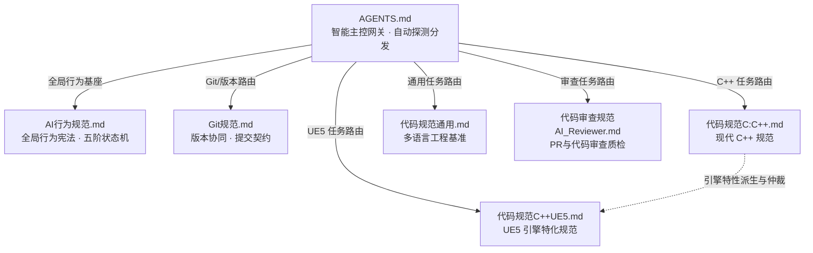

# AI Coding Standards (AI 编程规范体系)

> 面向 AI 编程助手（Agent）的模块化规范体系，首创 **"智能主控网关 + 行为规范与代码规范彻底解耦"** 架构。  
> 覆盖全局 AI Agent 工作流、通用多语言、现代 C++ 以及 UE5 游戏引擎四大维度，可无缝嵌入 Trae / Cursor / Copilot / Windsurf / Claude 等主流 AI 工具。

---

## 终极极简使用方式：永远只需指定一个文件 —— `AGENTS.md`

为了彻底解决人类使用者在不同语言、不同工具间频繁切换配置的心智负担，本项目配备了 **自举式智能主控网关 ([AGENTS.md](./AGENTS.md))**：

* **无论使用什么 AI IDE / 工具**：你在对话中**永远只需要给 AI 这一个文件**（如 `@AGENTS.md 帮我写一个xxx`），或将 `AGENTS.md` 作为项目唯一的 System Prompt。
* **AI 自动化自举执行**：
  1. `AGENTS.md` 内置了不可跳过的**行为宪法（计划先行、严格最小变更、非必死不判断）**，哪怕 AI 偷懒不去读长篇技术细节，核心防越权机制仍然 100% 生效！
  2. `AGENTS.md` 自带**动态任务路由器**，AI 会根据你的指令关键词自动探测领域（C++ / UE5 / 通用 / 审查），并主动在后台调阅对应的领域代码规范，绝不浪费无关 Token，绝不产生跨语言认知污染。



---

## 仓库结构与定位

```
.
├── AGENTS.md                          # 【智能主控网关】唯一的总指挥入口！自动探测任务并分发子规范
├── README.md                          # 项目全局架构与拓扑指南
└── guidelines/                        # 【核心规范目录】所有专业子规范收拢于此
    ├── AI行为规范.md                  # 【全局通用】AI Agent 行为宪法、五阶执行模型(Stage-Gate)、CoT内省协议
    ├── Git规范.md                     # 【工程协作】提交权限铁律、提交格式契约、分支管理、SemVer、LFS
    ├── 代码规范(通用).md              # 【通用基准】多语言通用架构设计、类型安全、工程化与供应链安全
    ├── 代码规范(C:C++).md             # 【C++专用】现代 C++ (C++20/C++23) 核心语法、类结构、内存并发与性能
    ├── 代码规范(C++UE5).md            # 【UE5专用】基于 C++ 规范在 UE5 引擎反射、Gameplay 与网络复制下的特化适配
    └── 代码审查规范(AI_Reviewer).md   # 【审查质检】自动化 Code Review / PR 验收提示词与一票否决项
```

### 各规范职责划分

| 规范文件 | 定位与核心内容 | 适用场景 |
|---|---|---|
| **[AGENTS.md](./AGENTS.md)** | **智能主控总指挥网关**：内嵌不可跳过核心宪法、动态规范路由表、CoT 思考握手协议 | **日常使用向 AI 提供的唯一入口文件** |
| **[AI行为规范.md](./guidelines/AI行为规范.md)** | **Agent 最高行为协议**：五阶状态机、CoT 思考链内省协议、最小变更、YAGNI、必要防御原则、反模式清单与预检 Checklist | 所有编程任务的基础行为底座 |
| **[Git规范.md](./guidelines/Git规范.md)** | **版本协同与发布标准**：提交权限铁律（未获明确指令绝不提交）、结构化提交信息契约、分支命名模型、SemVer 规则、LFS 资产过滤 | 所有工程任务的 Git 提交、分支与版本管理 |
| **[代码规范(通用).md](./guidelines/代码规范(通用).md)** | **多语言通用技术基准**：七大架构原则、强类型标注、精确异常捕获、RAII/defer 资源安全、SQL 注入防御、12-Factor 配置、必要防御 | Python / JS / TS / Go / Java / Rust / C# 等通用项目 |
| **[代码规范(C:C++).md](./guidelines/代码规范(C:C++).md)** | **现代 C++ 专用技术标准**：15 层类结构严格排布、`explicit`/`noexcept`、`concept` 约束、`std::span`/`string_view` 生命周期安全、智能指针决策树、NRVO、必要防御 | 现代 C++ 专用项目（C++20/23/17） |
| **[代码规范(C++UE5).md](./guidelines/代码规范(C++UE5).md)** | **UE5 引擎特化标准**：UHT 反射宏体系（`UCLASS`/`UPROPERTY`）、GC 内存生命周期、网络复制与 RPC、Gameplay 架构、冲突仲裁表 | Unreal Engine 5 C++ 游戏开发 |
| **[代码审查规范(AI_Reviewer).md](./guidelines/代码审查规范(AI_Reviewer).md)** | **代码质检审查规则**：过度防御一票否决、函数内部零行内注释核查、越权变更识别、结构化评审报告输出契约 | PR / MR 审查、自动化 Code Review 提示词 |

### 冲突裁决优先级（高 ➔ 低）

1. **[AI行为规范](./guidelines/AI行为规范.md)**（行为安全、权限控制与协作流程具有一票否决权）
2. **UE5 引擎硬约束**（在 UE5 项目中，UHT/GC/网络同步约束优先于原生 C++ 语法）
3. **语言专用规范**（《代码规范(C:C++)》优先于《代码规范(通用)》）
4. **通用代码规范**
5. **用户未明确说明的个人风格偏好**

---

## 主流 AI 工具使用指引

本规范体系采用标准 Markdown 编写，具备**最高通用性与自包含性**，无须绑定任何专有插件：

- **日常对话直接使用（最推荐）**：
  直接在输入框中通过 `@` 挂载 `AGENTS.md`：
  ```text
  @AGENTS.md 帮我实现一个高效的 C++ 环形缓冲区。
  ```
  AI 读取 `AGENTS.md` 后，会自动激活核心宪法并路由读取《代码规范(C:C++)》，输出前先提交计划。
- **作为项目固定全局指令**：
  - **Cursor**：在 `.cursorrules` 中写入 `请严格遵循根目录下的 [AGENTS.md]。`
  - **Trae IDE**：在 Settings ➔ Rules 中将 `AGENTS.md` 设为 Project Rules。
  - **GitHub Copilot / Windsurf**：在 `.github/copilot-instructions.md` 或 `.windsurfrules` 中引入 `AGENTS.md`。

---

## 版本

| 规范 | 当前版本 | 日期 | 升级摘要 |
|---|---|---|---|
| **AGENTS (智能网关)** | **1.2.0** | 2026-10-16 | 宪法确立安全优化放行特权与注释纯粹性；新增禁擅自提交与客观深度验证核心公理 |
| **AI行为规范** | **1.4.0** | 2026-10-16 | 恢复铁律 5 深度验证；确立安全优化放行特权与注释纯粹性；新增严禁擅自 Git 提交铁律 |
| **代码规范(通用)** | **2.3.0** | 2026-10-16 | 新增注释纯粹性禁绝无意义碎碎念；新增第 8.3 节死代码与等价化简直接放行特权 |
| **代码规范(C:C++)** | **6.4.0** | 2026-10-17 | 第 9.2 节取消 .inl 模板文件分离，全部在 .h 中定义；复杂函数必须在类外定义且严禁内联 |
| **代码规范(C++UE5)** | **2.4.0** | 2026-10-17 | 全域对齐 UE5 官方 PascalCase 大驼峰命名；取消 .inl 模板分离，统一定义在 .h 中且严禁复杂函数内联 |
| **Git规范** | **1.0.0** | 2026-10-16 | 独立抽离发布；确立禁擅自提交铁律、提交格式契约、分支模型、SemVer 与 LFS 过滤 |
| **代码审查规范** | **1.2.0** | 2026-10-16 | 质检项 2 增加注释纯粹性否决项；质检项 3 增加安全死代码与等价化简放行特权 |

版本严格遵循 [语义化版本 (SemVer)](https://semver.org/lang/zh-CN/) 规范。

---

## 贡献规范

欢迎提交 Issue 或 Pull Request。提交信息**必须**遵循以下格式契约：

```
[类型]: 简短概括本次变更目的
- 变更描述01（说明改了什么以及为什么改）
- 变更描述02
...
```

类型标签：`feat`（新规范/功能）/ `fix`（修正）/ `docs`（文档）/ `style`（排版）/ `refactor`（重构）/ `chore`（日常维护）。

---

## License

MIT
