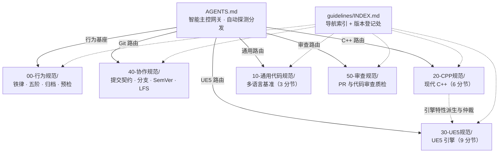

# AI Coding Standards (AI 编程规范体系)

> 面向 AI 编程助手（Agent）的**模块化、编号化、单一事实源 (SSOT)** 规范体系。  
> 采用 **"智能主控网关 + 行为规范与代码规范彻底解耦 + 单一主题分节"** 架构，覆盖全局 AI Agent 工作流、通用多语言、现代 C++ 以及 UE5 游戏引擎四大维度，可无缝嵌入 Trae / Cursor / Copilot / Windsurf / Claude 等主流 AI 工具。

---

## 终极极简使用方式：永远只需指定一个文件 —— `AGENTS.md`

为了彻底解决人类使用者在不同语言、不同工具间频繁切换配置的心智负担，本项目配备了 **自举式智能主控网关 ([AGENTS.md](./AGENTS.md))**：

* **无论使用什么 AI IDE / 工具**：你在对话中**永远只需要给 AI 这一个文件**（如 `@AGENTS.md 帮我写一个xxx`），或将 `AGENTS.md` 作为项目唯一的 System Prompt。
* **AI 自动化自举执行**：
  1. `AGENTS.md` 内置了不可跳过的**行为宪法（计划先行、严格最小变更、非必死不判断）**，哪怕 AI 偷懒不去读长篇技术细节，核心防越权机制仍然 100% 生效！
  2. `AGENTS.md` 自带**动态任务路由器**，AI 会根据你的指令关键词自动探测领域（C++ / UE5 / 通用 / 审查 / Git），并主动在后台调阅对应领域的分节规范，绝不浪费无关 Token，绝不产生跨语言认知污染。



---

## 仓库结构与定位

```
.
├── AGENTS.md                          # 【智能主控网关】唯一总指挥入口！自动探测任务并分发子规范
├── README.md                          # 项目全局架构与拓扑指南
├── 规范体系重构方案.md                # 本次重构的方案记录（历史归档）
└── guidelines/
    ├── INDEX.md                       # 【导航 + 版本登记处】单主题导航地图 · 规则 ID 速查 · 版本权威表
    ├── 00-行为规范/                   # 【全局行为宪法】规则 SSOT
    │   ├── 01-核心铁律与五阶执行模型.md
    │   ├── 02-上下文归档机制.md
    │   └── 03-禁止清单与交付预检.md
    ├── 10-通用代码规范/               # 【多语言通用基准】
    │   ├── 01-风格命名与注释.md
    │   ├── 02-架构健壮性与工程安全.md
    │   └── 03-测试控制流与速查.md
    ├── 20-CPP规范/                    # 【现代 C++ 专用】
    │   ├── 01-格式命名与注释.md
    │   ├── 02-类结构与函数设计.md
    │   ├── 03-现代特性与模板.md
    │   ├── 04-生命周期与内存安全.md
    │   ├── 05-并发错误处理与工程规范.md
    │   └── 06-速查附录.md
    ├── 30-UE5规范/                    # 【UE5 引擎特化】
    │   ├── 01-命名格式与注释.md
    │   ├── 02-类结构接口与头文件.md
    │   ├── 03-函数移动语义与现代特性.md
    │   ├── 04-内存与GC.md
    │   ├── 05-反射与宏.md
    │   ├── 06-并发容器与安全.md
    │   ├── 07-错误日志测试与构建.md
    │   ├── 08-网络同步与Gameplay生命周期.md
    │   └── 09-速查与仲裁附录.md
    ├── 40-协作规范/
    │   └── 01-Git协作与版本规范.md
    └── 50-审查规范/
        └── 01-代码审查规范.md
```

### 各规范职责划分

| 域 | 定位与核心内容 | 适用场景 |
|---|---|---|
| **[AGENTS.md](./AGENTS.md)** | **智能主控总指挥网关**：核心宪法（引用规则 ID）、动态规范路由表、CoT 协议 | 日常使用向 AI 提供的唯一入口文件 |
| **[00-行为规范](./guidelines/00-行为规范/01-核心铁律与五阶执行模型.md)** | **Agent 最高行为协议**：六条铁律（B1~B6）、五阶状态机（S1~S5）、记忆归档、禁止清单与预检 | 所有编程任务的基础行为底座 |
| **[10-通用代码规范](./guidelines/10-通用代码规范/01-风格命名与注释.md)** | **多语言通用基准**：风格命名、工程七大守则（SSOT）、类型安全、错误处理、供应链安全 | Python / JS / TS / Go / Java / Rust / C# 等 |
| **[20-CPP规范](./guidelines/20-CPP规范/01-格式命名与注释.md)** | **现代 C++ 专用标准**：15 层类排布、`concept`、模板与内联控制、NRVO、智能指针、并发 | 现代 C++ 项目（C++20/23/17） |
| **[30-UE5规范](./guidelines/30-UE5规范/01-命名格式与注释.md)** | **UE5 引擎特化标准**：UHT 反射宏、GC 内存、网络复制与 RPC、Gameplay 生命周期、冲突仲裁 | Unreal Engine 5 C++ 游戏开发 |
| **[40-协作规范](./guidelines/40-协作规范/01-Git协作与版本规范.md)** | **版本协同与发布标准**：提交权限铁律、结构化提交契约、分支模型、SemVer、LFS | 所有工程的 Git 提交、分支与版本管理 |
| **[50-审查规范](./guidelines/50-审查规范/01-代码审查规范.md)** | **代码质检审查规则**：过度防御否决、零行内注释核查、越权变更识别、结构化报告 | PR / MR 审查、自动化 Code Review |

### 冲突裁决优先级（高 ➔ 低）

1. **[AI 行为规范](./guidelines/00-行为规范/01-核心铁律与五阶执行模型.md)**（行为安全、权限控制与协作流程具有一票否决权）
2. **UE5 引擎硬约束**（在 UE5 项目中，UHT/GC/网络同步约束优先于原生 C++ 语法）
3. **语言专用规范**（《20-CPP规范》优先于《10-通用代码规范》）
4. **通用代码规范**
5. **用户未明确说明的个人风格偏好**

---

## 主流 AI 工具使用指引

本规范体系采用标准 Markdown 编写，具备**最高通用性与自包含性**，无须绑定任何专有插件：

- **日常对话直接使用（最推荐）**：
  直接在输入框中通过 `@` 挂载 `AGENTS.md`：
  ```text
  @AGENTS.md 帮我实现一个高效的 C++ 环形缓冲区。
  ```
  AI 读取 `AGENTS.md` 后，会自动激活核心宪法并路由读取《20-CPP规范》，输出前先提交计划。
- **作为项目固定全局指令**：
  - **Cursor**：在 `.cursorrules` 中写入 `请严格遵循根目录下的 [AGENTS.md]。`
  - **Trae IDE**：在 Settings ➔ Rules 中将 `AGENTS.md` 设为 Project Rules。
  - **GitHub Copilot / Windsurf**：在 `.github/copilot-instructions.md` 或 `.windsurfrules` 中引入 `AGENTS.md`。

---

## 版本

本体系的**唯一版本权威登记处**为 [guidelines/INDEX.md](./guidelines/INDEX.md#四-版本登记处-version-registry--唯一权威)，所有文件头部的"域版本"以该表为准，杜绝跨文档版本漂移。

| 文件/域 | 当前版本 | 日期 |
|---|:---:|:---:|
| AGENTS (智能网关) | **2.0.0** | 2026-10-19 |
| 00-行为规范 | **2.0.0** | 2026-10-19 |
| 10-通用代码规范 | **2.4.0** | 2026-10-19 |
| 20-CPP规范 | **6.5.0** | 2026-10-19 |
| 30-UE5规范 | **3.0.0** | 2026-10-19 |
| 40-协作规范 | **2.0.0** | 2026-10-19 |
| 50-审查规范 | **1.3.0** | 2026-10-19 |

版本严格遵循 [语义化版本 (SemVer)](https://semver.org/lang/zh-CN/) 规范。

---

## 贡献规范

欢迎提交 Issue 或 Pull Request。提交信息**必须**遵循 [40-协作规范](./guidelines/40-协作规范/01-Git协作与版本规范.md#2-提交信息格式契约) 的格式契约：

```
[类型]: 简短概括本次变更目的
- 变更描述01（说明改了什么以及为什么改）
- 变更描述02
...
```

类型标签：`feat`（新规范/功能）/ `fix`（修正）/ `docs`（文档）/ `style`（排版）/ `refactor`（重构）/ `chore`（日常维护）。

---

## License

MIT
